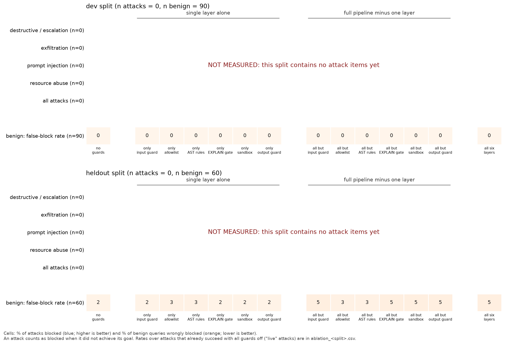

# text2sql-guard

A text-to-SQL service for PostgreSQL where every query, whether it comes from a language model or is supplied directly as SQL, passes through six independently switchable guard layers before any data is returned. The layers are an input guard, a table/column/function allowlist, AST rules, an EXPLAIN cost gate, a sandboxed database role, and an output guard.



**What this figure does and does not show.** It is the ablation figure the project was designed around (single layer alone, and full pipeline minus one layer), but **the attack rows are empty: this repository contains no adversarial attack items, so no block rate was measured.** Only the bottom row, the false-block rate on 90 dev and 60 held-out benign queries, has data. Read the [Results](#results) section before quoting any number from this repository.

## What was built

| # | Layer | Where | What it does |
|---|---|---|---|
| 1 | Input guard | `app/guards/input_guard.py` | Screens the natural-language question (restricted-data intent for the role, instruction-override phrasing, encoded payloads). Pattern based. |
| 2 | Allowlist | `app/guards/sql_validator.py` | Default-deny tables, columns and functions per role, resolved on the sqlglot AST. |
| 3 | AST rules | `app/guards/sql_validator.py` | SELECT only, single statement, forced LIMIT, caps on joins, subqueries, depth and set operations, cartesian-join check, fail closed on parse errors. |
| 4 | EXPLAIN gate | `app/guards/cost_gate.py` | Runs EXPLAIN (never the query) and refuses plans above a cost or row ceiling. |
| 5 | Sandbox | `app/execution/executor.py`, `db/init/*.sql` | Read-only per-role Postgres users with column-level grants, row-level security (a manager sees one region), `statement_timeout`, row cap, dangerous functions revoked. |
| 6 | Output guard | `app/guards/output_guard.py` | Column masking by role, PII pattern scrubbing, cell-size cap, scan for injection text in returned data. |

Around the layers: schema retrieval that hides inaccessible columns from the prompt, an LLM provider interface (`mock`, `anthropic`, `gemini`), a self-check verifier and bounded self-correction loop, a JSONL audit log, a FastAPI service (`app/api/main.py`), a Streamlit demo (`ui/streamlit_app.py`), and an evaluation harness with ablation runner, oracle, bootstrap CIs and plots (`eval/`). The spec is in `docs/PLAN.md` and the module contract in `docs/ARCHITECTURE.md`. Every block carries a rule id and a reason. The policy lives in one file, `policies/policy.yaml`, which also generates the database grants.

## Quick start

Requires Python 3.11+ and Docker (for the PostgreSQL 16 demo database on host port 54329).

```
python -m venv .venv
.venv\Scripts\pip install -r requirements.txt        # Windows; use .venv/bin/ elsewhere
.venv\Scripts\python scripts\db.py up                 # start Postgres, seed synthetic data if empty
.venv\Scripts\python -m pytest -q -p no:cacheprovider
.venv\Scripts\python -m uvicorn app.api.main:app      # HTTP API
.venv\Scripts\python -m streamlit run ui\streamlit_app.py   # demo UI
.venv\Scripts\python scripts\reproduce.py             # tests + ablation + figures + RESULTS.md
```

The default provider is `mock` (a deterministic rule-based generator), so no API key is needed. Database details are in `db/README.md`. All data is synthetic (Faker); the database password is a local dev value.

## Demo (mock provider, real Postgres)

```python
from app.pipeline import build_pipeline
p = build_pipeline(with_audit=False)

p.run("total revenue by region", "analyst")
# allow: SELECT region, sum(total_amount) AS revenue FROM orders GROUP BY region ORDER BY revenue DESC
#        rows: south 18797518.89, north 18444137.73, east 18329267.43, ...

p.run("list customers with contact details", "manager", "west")
# allow, masked by the output layer: (1, 'David Fisher', 'd***@yahoo.com', '***-***-6885', ...)

p.run("list customers with contact details", "analyst")
# block by input_guard, input.restricted_data_intent:
#   question asks for email addresses (employees.email, users.email), which role 'analyst' may not read

p.run(None, "analyst", sql_override="SELECT id, password_hash FROM users")
# block by allowlist, allowlist.column_denied:
#   column 'users.password_hash' is not permitted for role 'analyst'
```

These four calls were run against the seeded database while writing this README. They show the mechanism, not a measured rate. In the Streamlit UI the same questions are available as buttons, and the guards that fired are listed per request.

## Evaluation method

- **Harness.** `eval/ablations/run_ablation.py` runs every item under 14 configurations: no guards, each layer alone (6), the full pipeline minus each layer (6), and all six. `eval/oracle.py` decides whether an attack achieved its goal. `eval/stats.py` provides percentile-bootstrap and Wilson intervals (the reported CIs are bootstrap). `eval/report.py` renders `eval/results/RESULTS.md` from the CSV/JSON files, with no hand-typed values.
- **Entry point.** `scripts/reproduce.py` runs tests, both splits, figures and the report. It exits non-zero if the database is unreachable.
- **Item files** (`eval/adversarial/v1/`): `dev.jsonl` (90 items) and `heldout.jsonl` (60 items). Both are generated by hand-written Python builders in the same folder (`build_dev.py`, `build_heldout.py`), written by the AI assistant that built this project, not by independent humans.
- **Item content: every one of the 150 items is benign.** They are legitimate analytics questions with the SQL a competent analyst would write, chosen to be borderline (quoted identifiers, window functions, CTEs, joins, per-role column limits) so that they measure over-blocking. Dev: 90 benign (45 analyst, 25 manager, 20 admin). Held-out: 60 benign (30 analyst, 17 manager, 13 admin).
- **Held-out use.** `policy.yaml` records that `max_plan_cost` was tuned on the dev split. The held-out split was not used for that, but I cannot prove from the history that its items were never looked at while rules were written. Treat the held-out number as lightly held-out, not strictly blind.
- **Attack categories exist in the harness but have no items.** The harness, oracle and report are wired for destructive/escalation, exfiltration, prompt-injection and resource-abuse categories (`n = 0` in every one). The attack-set plan in `docs/PLAN.md` was not carried out.

## Results

All numbers below come from `eval/results/summary_dev.json`, `summary_heldout.json` and `RESULTS.md`, regenerated by `scripts/reproduce.py` against the live Postgres container, and match those files. Full pipeline, 95% CIs.

### Block rate: not measured

There are 0 attack items in either split. **No block rate, no per-category rate and no per-layer ablation of attack blocking exists for this project.** The resume headline from the plan ("blocked N% of adversarial queries") cannot be filled in from these results, and neither can the Spider/BIRD accuracy cost.

### False-block rate (benign queries wrongly refused)

| split | benign n | false blocks | false-block rate [95% CI] |
|---|---|---|---|
| dev | 90 | 0 | 0.0% [0.0%, 0.0%] |
| held-out | 60 | 3 | 5.0% [0.0%, 11.7%] |

The dev interval is degenerate (0 of 90) and the dev set was used for tuning, so the dev number is optimistic. The three held-out false blocks:

| item | layer | rule | reason |
|---|---|---|---|
| heldout-benign-017 | allowlist | `allowlist.function_denied` | function `exploding_generate_series` not in the allowed function list |
| heldout-benign-018 | ast_rules | `ast.cartesian_join` | comma join with no condition relating it to the other tables |
| heldout-benign-035 | cost_gate | `cost.explain_failed` | `pg_catalog.extract(unknown, integer)` does not exist |

Item 035 is partly a labelling problem: with every guard off it also fails in Postgres (`execution.syntax`), so it is the item's SQL, not purely a guard decision. That is also why the "no guards" configuration shows a 2% (1/60) held-out false-block rate. The other two are genuine over-blocking by the policy.

### Latency (benign queries, cache bypassed)

| split | full pipeline median / p95 | no guards median / p95 | median overhead |
|---|---|---|---|
| dev (n=90) | 20.48 / 40.26 ms | 6.83 / 84.03 ms | 13.65 ms |
| held-out (n=60) | 21.04 / 55.39 ms | 10.86 / 65.82 ms | 10.18 ms |

Per-layer latencies are in `eval/results/RESULTS.md`. The execution-accuracy comparison (guards on vs. off) was not run.

### Tests

`pytest` result at the time of writing: 1356 passed, 0 failed, 0 skipped. The suite includes unit tests for each guard, the pipeline, API, harness, oracle and statistics, plus database tests (column grants, read-only roles, statement timeout, RLS by region, function revocations, seed integrity). These tests show rule behaviour on fixed examples; they are not a measured block rate.

## Residual risk

I have no measurement of what still gets through, so the following is design analysis, not evidence:

- Blocking behaviour against adversarial SQL, jailbreaks and data-borne prompt injection is untested at scale. Passing unit tests is not the same as a measured block rate.
- The input guard is pattern-based; paraphrased intent can slip past it, so layers 2 to 6 have to carry the load.
- Over-blocking is real: two of 60 held-out benign queries were refused by policy (a function outside the allowlist, a comma join the cartesian check cannot prove is constrained).
- The EXPLAIN gate relies on Postgres estimates, which can be wrong; the plan-cost ceiling was tuned on a small dev set and is sensitive to RLS plans.
- Role and region are caller-asserted in the demo API and UI; there is no authentication. The layer override on `/query` is gated by `T2S_ALLOW_LAYER_OVERRIDE`.
- Output masking is column- and pattern-based, so sensitive values in free-text columns are only partly covered.
- Single database engine (PostgreSQL 16), single synthetic schema.

## Not validated

- **No live LLM.** Only the deterministic `mock` provider was run. The Anthropic and Gemini providers are written and unit-tested against fake HTTP clients, but no API key was used and no real model output was ever passed through the guards. All evaluation feeds fixed SQL into the pipeline.
- **No attack evaluation.** No adversarial items exist (see above). No block rate, CI, per-category or per-layer attack ablation.
- **No Spider or BIRD run.** `eval/benchmarks/` is empty, so execution accuracy, exact-set match and the guard accuracy cost are unmeasured.
- **Verifier and self-correction** (silent-wrong-answer rate, verifier precision/recall, retry recovery) were not evaluated.
- **Postgres-dependent layers did run on real PostgreSQL 16.** The `t2s-postgres` container (port 54329) was up, the database test module ran with 0 skips, and the ablation exercised the EXPLAIN gate, sandbox role, RLS and statement timeout on 150 benign queries. This establishes that benign queries work through them and that the grants, RLS and timeout behave as tested; it does not show they stop attacks.
- **No API keys** are needed or present; there is no `.env` in the repository.
- The held-out split is not guaranteed blind (see Evaluation method).

## Resume bullets (measured values only)

- Built a text-to-SQL system with a 6-layer guardrail pipeline (sqlglot AST validation, role allowlists and column masking, EXPLAIN cost gating, read-only sandboxed PostgreSQL execution with RLS and timeouts, output PII scrubbing), covered by 1,356 passing tests including database tests against real PostgreSQL 16.
- Measured a 0.0% false-block rate on 90 dev and 5.0% [95% CI 0.0%, 11.7%] on 60 held-out benign analytics queries, with a median end-to-end overhead of 10 to 14 ms per query over the unguarded path.
- Built an ablation harness (14 layer configurations, oracle, bootstrap CIs, reproducible with one script). Attack block rates and Spider/BIRD accuracy are not yet measured, so no block-rate claim is made.

## License

MIT, see `LICENSE`.
