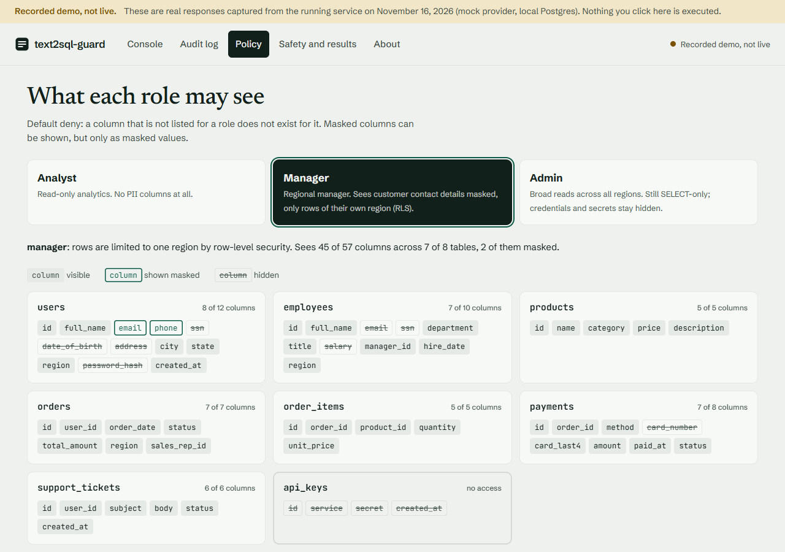
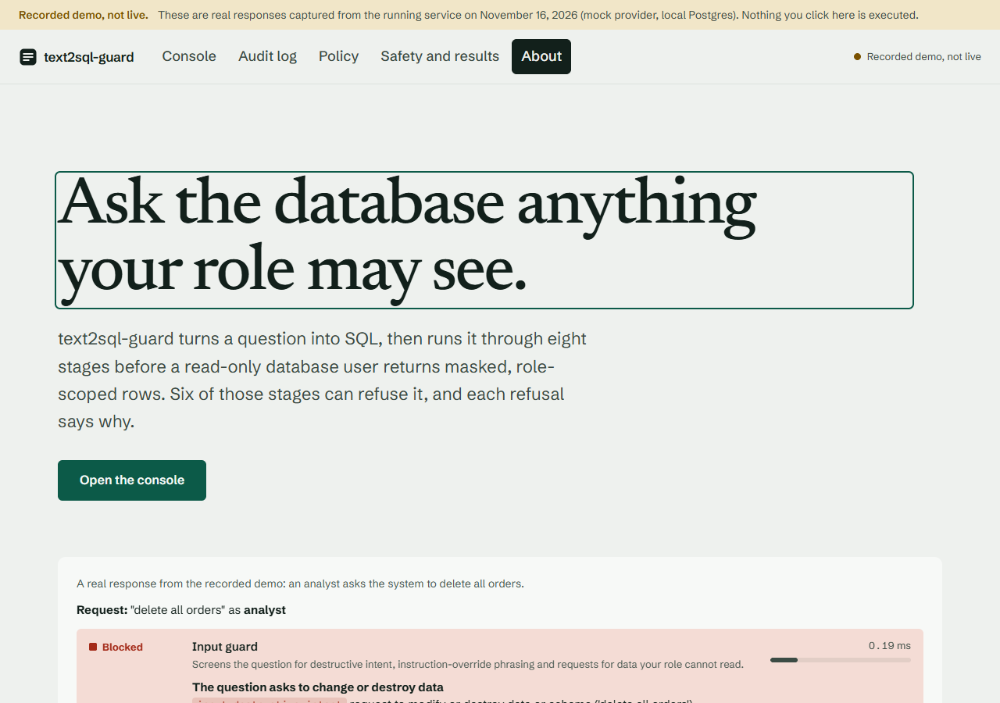
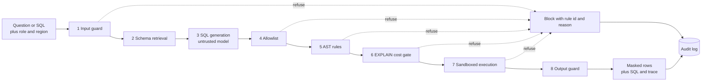

# text2sql-guard


   

**text2sql-guard is a text-to-SQL service for PostgreSQL that treats the language model as untrusted.** A question (or raw SQL) is turned into a query and then passes eight stages, six of which can refuse it, before a read-only database user returns rows that are masked and scoped to the caller's role. Every refusal carries a rule id and a plain-language reason, every request is logged, and the whole policy lives in one file that also generates the database grants. It ships with a web app (query console, audit log, policy explorer, results page), a landing page, and a recorded demo that runs without a backend.

What it does **not** have, stated up front: no attack block rate was measured (the evaluation contains zero attack items), no live LLM has been run through it, and there is no authentication. See [Not validated](#not-validated).

## The web app

Start the API and open `http://127.0.0.1:8000/`. The same server serves the landing page at `/about`.

| Screen | What it shows |
|---|---|
| **Console** | Pick a role, ask a question (or type SQL), see the generated SQL with highlighting, an 8-stage trace (passed, blocked or not reached, with rule id, plain reason and per-stage latency), the masked result table and the verifier result. |
| **Audit log** | Every request, newest first, filterable by decision, rule and role, with the stage timings of each. |
| **Policy** | For each role, which tables and columns are visible, masked, or hidden, and the limits that apply. |
| **Safety and results** | The measured numbers from `eval/results`, with the missing attack rate stated plainly. |
| **About** (`/about`) | What the product is, how it fails closed, and what it does not guarantee. |

| Blocked request | Policy explorer |
|---|---|
|  |  |

| Safety and results | Landing page | Phone |
|---|---|---|
|  |  |  |

### Recorded demo (no backend)

`web/demo.html` (or `web/index.html?demo=1`) replays real responses captured from the running service against the mock provider and the local Postgres container. It is labelled **"Recorded demo, not live"** on screen and nothing in it executes. The recording is `web/data/demo.json`, produced by `scripts/capture_demo.py`; it is also what the app falls back to automatically when no API answers. To host it, publish the contents of `web/` on any static host (for a quick look: `python -m http.server` inside `web/`).

The front end is plain HTML, CSS and JavaScript with no build step and no dependencies; only the web fonts load from Google Fonts, with system fallbacks.

## Quick start

Requires Python 3.11+ and Docker (for the PostgreSQL 16 demo database on host port 54329). The default provider is `mock`, a deterministic rule-based generator, so no API key is needed.

```
python -m venv .venv
.venv\Scripts\pip install -r requirements.txt        # Windows; use .venv/bin/ elsewhere
docker compose up -d                                  # PostgreSQL 16 (or: python scripts\db.py up, which also seeds)
.venv\Scripts\python scripts\db.py up                 # waits until the database is usable and seeds it if empty
.venv\Scripts\python -m uvicorn app.api.main:app      # API + web app at http://127.0.0.1:8000
.venv\Scripts\python -m pytest -q -p no:cacheprovider
.venv\Scripts\python -m streamlit run ui\streamlit_app.py   # the original Streamlit demo, optional
.venv\Scripts\python scripts\reproduce.py             # tests + ablation + figures + RESULTS.md
```

All data is synthetic (Faker); the database password is a local dev value. Database details are in `db/README.md`. Without Docker the API still starts and serves the app, but queries that need Postgres fail; use the recorded demo instead.

Refreshing the web data after a new evaluation run:

```
.venv\Scripts\python scripts\build_web_data.py                       # eval/results -> web/data/results.json
.venv\Scripts\python scripts\capture_demo.py --base http://127.0.0.1:8000   # re-record web/data/demo.json (mock provider only)
```

## How a request flows



| # | Stage | Where | What it does |
|---|---|---|---|
| 1 | Input guard | `app/guards/input_guard.py` | Screens the question for restricted-data intent for the role, destructive intent, instruction-override phrasing and encoded payloads. Pattern based. |
| 2 | Schema retrieval | `app/generation/` | Shows the model only the tables and columns the role may see. Not a gate. |
| 3 | SQL generation | `app/generation/` | Provider interface (`mock`, `anthropic`, `gemini`), self-check verifier and bounded self-correction. Not a gate. |
| 4 | Allowlist | `app/guards/sql_validator.py` | Default-deny tables, columns and functions per role, resolved on the sqlglot AST. |
| 5 | AST rules | `app/guards/sql_validator.py` | SELECT only, single statement, forced LIMIT, caps on joins, subqueries, depth and set operations, cartesian-join check, fail closed on parse errors. |
| 6 | EXPLAIN cost gate | `app/guards/cost_gate.py` | Runs EXPLAIN (never the query) and refuses plans above a cost or row ceiling. |
| 7 | Sandbox | `app/execution/executor.py`, `db/init/*.sql` | Read-only per-role Postgres users with column-level grants, row-level security (a manager sees one region), `statement_timeout`, row cap, dangerous functions revoked. |
| 8 | Output guard | `app/guards/output_guard.py` | Column masking by role, PII pattern scrubbing, cell-size cap, scan for injection text in returned data. |

The ablation harness treats stages 1 and 4 to 8 as six independently switchable layers (`input_guard`, `allowlist`, `ast_rules`, `cost_gate`, `sandbox`, `output_guard`). Design rules: default deny, fail closed, enforcement in code and database permissions and never in the prompt, every block carries a rule id and a reason. The contract for each module is in `docs/ARCHITECTURE.md`; the original spec is `docs/PLAN.md`.

## Role and policy model

`policies/policy.yaml` is the single source of truth for the validator, the output guard, the generated database grants and the evaluation oracle. Anything not listed for a role is refused.

| Role | Sees | Row scope |
|---|---|---|
| `analyst` | Analytics columns only, no PII | all rows |
| `manager` | Customer name, city and similar, with email and phone masked | one region (row-level security) |
| `admin` | Broad reads across regions; credentials and secrets stay hidden | all rows |

The Policy screen in the app renders the exact column-level view for each role from the live policy. Role and region are **asserted by the caller** in this demo; a real deployment must derive them from an authenticated session.

## Evaluation method

- **Harness.** `eval/ablations/run_ablation.py` runs every item under 14 configurations: no guards, each layer alone (6), the full pipeline minus each layer (6), and all six. `eval/oracle.py` decides whether an attack achieved its goal. `eval/stats.py` provides percentile-bootstrap and Wilson intervals (the reported CIs are bootstrap). `eval/report.py` renders `eval/results/RESULTS.md` from the CSV and JSON files, with no hand-typed values; the web results page reads the same files through `scripts/build_web_data.py`.
- **Item files** (`eval/adversarial/v1/`): `dev.jsonl` (90 items) and `heldout.jsonl` (60 items), generated by hand-written Python builders in the same folder, written by the AI assistant that built this project, not by independent humans.
- **Item content: all 150 items are benign.** They are legitimate analytics questions with the SQL a competent analyst would write, chosen to be borderline (quoted identifiers, window functions, CTEs, joins, per-role column limits) so that they measure over-blocking. Dev: 90 benign (45 analyst, 25 manager, 20 admin). Held-out: 60 benign (30 analyst, 17 manager, 13 admin).
- **Held-out use.** `max_plan_cost` was tuned on the dev split. The held-out split was not used for that, but I cannot prove from the history that its items were never looked at while rules were written. Treat the held-out number as lightly held-out, not strictly blind.
- **Attack categories exist in the harness but have no items.** The harness, oracle and report are wired for destructive/escalation, exfiltration, prompt-injection and resource-abuse categories (`n = 0` in every one). The attack-set plan in `docs/PLAN.md` was not carried out.

## Results

Every number below is read from `eval/results/summary_dev.json`, `summary_heldout.json`, `latency_*.csv` and `RESULTS.md` (generated 2026-11-16 against the live Postgres container). Full pipeline, 95% bootstrap intervals. Dev and held-out are kept separate.

### Attack block rate: not measured

There are 0 attack items in either split. **No block rate, no per-category rate and no per-layer attack ablation exists for this project.** Spider/BIRD accuracy is also unmeasured.

### False-block rate (benign queries wrongly refused)

| split | benign n | false blocks | false-block rate [95% CI] | note |
|---|---|---|---|---|
| dev | 90 | 0 | 0.0% [0.0%, 0.0%] | used while tuning, so optimistic; the interval is degenerate |
| held-out | 60 | 3 | 5.0% [0.0%, 11.7%] | lightly held-out, not strictly blind |

The three held-out false blocks:

| item | layer | rule | reason |
|---|---|---|---|
| heldout-benign-017 | allowlist | `allowlist.function_denied` | function `exploding_generate_series` not in the allowed function list |
| heldout-benign-018 | ast_rules | `ast.cartesian_join` | comma join with no condition relating it to the other tables |
| heldout-benign-035 | cost_gate | `cost.explain_failed` | `pg_catalog.extract(unknown, integer)` does not exist |

Item 035 is partly a labelling problem: with every guard off it also fails in Postgres, so it is the item's SQL, not purely a guard decision. That is also why the "no guards" configuration shows 1 of 60 held-out false blocks. The other two are genuine over-blocking by the policy.

### Latency (benign queries, cache bypassed, mock provider so no model time)

| split | full pipeline median / p95 | no guards median / p95 | median overhead |
|---|---|---|---|
| dev (n=90) | 16.54 / 30.18 ms | 6.08 / 62.57 ms | 10.46 ms |
| held-out (n=60) | 18.09 / 42.58 ms | 9.76 / 60.16 ms | 8.33 ms |

Per-stage latencies are on the results page and in `eval/results/RESULTS.md`. The execution-accuracy comparison (guards on versus off) was not run.

### Tests

`pytest -q -p no:cacheprovider` on this commit: **1358 passed**, 0 failed (the evaluation snapshot above recorded 1356; two tests were added for the `/catalog` endpoint and the web mount). The suite covers each guard, the pipeline, the API, the harness, the oracle and statistics, plus database tests against PostgreSQL 16 (column grants, read-only roles, statement timeout, RLS by region, function revocations, seed integrity). These tests check rule behaviour on fixed examples; they are not a measured block rate.

## Residual risk

This is design analysis, not measurement:

- Blocking behaviour against adversarial SQL, jailbreaks and data-borne prompt injection is untested at scale.
- The input guard is pattern based; paraphrased intent can slip past it, so the later layers carry the load.
- Over-blocking is real: two of 60 held-out benign queries were refused by policy.
- The EXPLAIN gate relies on Postgres estimates, which can be wrong; the plan-cost ceiling was tuned on a small dev set and is sensitive to RLS plans.
- Role and region are caller-asserted in the demo API, web app and Streamlit UI; there is no authentication. Switching guard layers off through the API is disabled unless `T2S_ALLOW_LAYER_OVERRIDE=1`.
- Output masking is column and pattern based, so sensitive values in free-text columns are only partly covered.
- Single database engine (PostgreSQL 16), single synthetic schema.

## Not validated

- **No live LLM.** Only the deterministic `mock` provider was run, including for the web app and the recorded demo. The Anthropic and Gemini providers are unit-tested against fake HTTP clients, but no API key was used and no real model output was ever passed through the guards. The self-check shows "not verified" under the mock provider.
- **No attack evaluation.** No adversarial items exist. No block rate, interval, per-category or per-layer attack ablation.
- **No Spider or BIRD run.** `eval/benchmarks/` is empty, so execution accuracy and the accuracy cost of the guards are unmeasured.
- **Verifier and self-correction** (silent-wrong-answer rate, precision and recall, retry recovery) were not evaluated.
- **Postgres-dependent layers did run on real PostgreSQL 16** for the 150 benign queries and the database tests. That shows benign queries work through them and the grants, RLS and timeout behave as tested; it does not show they stop attacks.
- **Web app:** checked in a real browser at desktop and phone widths and with an automated accessibility audit (no violations reported on the console, About and results pages); not tested on other browsers, and no load testing.
- No API keys are needed or present; there is no `.env` in the repository.

## Project layout

```
app/            pipeline, guards, executor, generation, audit log, FastAPI service (app/api)
web/            web app, landing page, recorded demo (static, no build step); web/data holds the JSON it reads
policies/       policy.yaml, the single source of truth
db/             schema, seed data, generated grants, Docker init scripts
eval/           harness, oracle, statistics, ablations, results, benchmarks (empty)
scripts/        db.py, reproduce.py, build_web_data.py, capture_demo.py
tests/          offline and database tests
ui/             Streamlit demo
docs/           PLAN.md, ARCHITECTURE.md, figures, screenshots
```

## Roadmap

Not done, in rough priority order: author and review an independent attack set and report block rates with intervals; run a live model through the guards; run Spider/BIRD to measure the accuracy cost; replace caller-asserted roles with authenticated sessions; evaluate the verifier and self-correction loop; broaden masking beyond column and pattern rules.

## License

MIT, see `LICENSE`.
